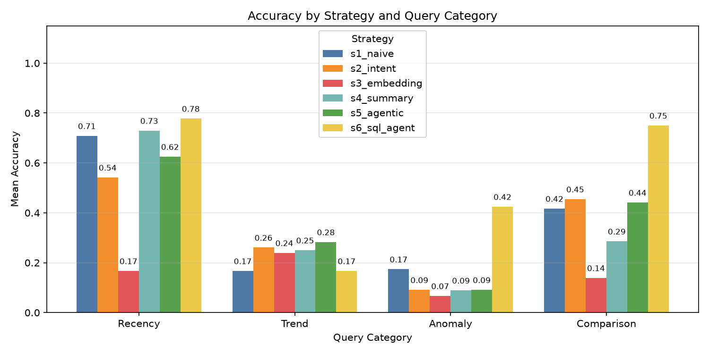
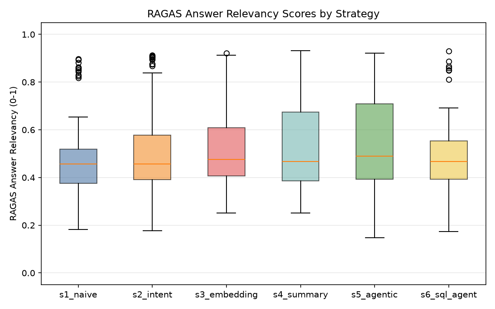

# Context-Feed Evaluation Pipeline

**A Comparative Evaluation of Context-Feeding Strategies for LLM-Based Natural Language Querying over Streaming Tabular Data**

UKZN CS Honours 2026 — Kirone Gopaul (223014456)
Supervisor: Prof Okuthe P. Kogeda

---

## What This Is

A controlled experiment comparing six ways to select data for an LLM's context window when answering questions about a live stock data stream. The only variable between runs is *which strategy picks the context* — everything else (model, decoding parameters, queries, data) is held constant. The goal is to determine the most effective context-feeding architecture for tabular numerical reasoning.

## The Six Strategies

| ID | Strategy | Approach | Query-Aware? |
|---|---|---|---|
| **S1** | Naive Fixed Window | Last 50 rows, no filtering | No |
| **S2** | Query-Intent-Driven | Classifies intent -> dispatches to intent-specific logic | Yes |
| **S3** | Embedding Retrieval | Top-20 rows by cosine similarity to query | Yes |
| **S4** | Summarisation-Augmented | LLM summary of history + 20 recent rows | Partially |
| **S5** | Agentic Routing | Self-correcting critique and fallback loop | Yes |
| **S6** | Text-to-SQL Agent | SOTA code generation and deterministic execution | Yes |

## Results Overview

Standard text-injection RAG strategies (S1-S5) hit a hard accuracy ceiling on tabular numeric data due to the inherent mathematical limitations of LLMs. Agentic code generation (S6) bypassed this ceiling, achieving a statistically significant breakthrough in accuracy (51.2% vs baseline 36.5%).

### Accuracy by Category



### RAGAS Relevance



## Quick Start

### 1. Install dependencies

```bash
uv sync
```

### 2. Download stock data

```bash
uv run python scripts/01_fetch_data.py
```

Downloads ~1 year of daily OHLCV for AAPL, GOOG, MSFT, TSLA (~1000 rows total). Cached locally — only downloads once.

### 3. Start Inference Engine (Ollama)

```bash
ollama pull mistral:7b
ollama serve
```

### 4. Run evaluation

```bash
uv run python scripts/02_run_evaluation.py              # Full run
uv run python scripts/02_run_evaluation.py --skip-judge  # Skip relevance scoring (faster)
```

## Evaluation Metrics

| Metric | Method |
|---|---|
| **Accuracy** | Programmatic ground truth — exact match, +/-1% numeric tolerance, or directional agreement |
| **Relevance** | LLM-as-judge (1-5 scale) and RAGAS Answer Relevancy (cosine similarity) |
| **Latency** | End-to-end milliseconds per query |

## Project Structure

```text
src/ctxfeed/          Main package
  config.py           YAML -> frozen dataclasses
  ingestion/          Data download and chronological replay
  storage/            Stream buffer (deque) and historical store (SQLite)
  formatting/         DataFrame -> Markdown tables
  strategies/         S1-S6, base ABC, and registry
  llm/                Ollama client and prompt templates
  evaluation/         Benchmark loader, metrics, judge, runner, results DB

config/config.yaml    All tuneable parameters
benchmarks/           Query-answer benchmark set (JSON)
scripts/              Entry-point scripts
docs/                 Architecture docs and strategy specs
```

## Documentation

- **[Architecture & Implementation Reference](docs/architecture.md)** — full module docs, design decisions, data flow, extension guide
- **[Strategy Specifications](docs/strategy_specs.md)** — exact parameters, selection logic, known limitations, scoring rubric

## Compute Setup

| Environment | Model | Purpose |
|---|---|---|
| Local laptop (GTX 3050) | Mistral 7B | Evaluation sweep and pipeline execution |

## License

Academic research project. All dependencies are open-source. Data from Yahoo Finance via yfinance.
